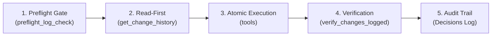

# Safe Google Ads FastMCP Manager — Enterprise Gateway (54 Tools)

Unified operational control center and deterministic execution gateway for `safe-google-ads-mcp` (Google Ads API v24 + Google Cloud Observability).

---

## 🛑 4 Non-Negotiable Invariants

1. **Portfolio Bidding Strategy Alignment (`TARGET_SPEND`)**:
   - Ad group and keyword-level `cpc_bid_micros` are ignored by Google Ads portfolio bidding.
   - The **sole effective bid lever** is the campaign CPC bid ceiling (`campaign.target_spend.cpc_bid_ceiling_micros`).
   - Bid increments are **strictly locked to `±0.05 EUR`** via `step_bid_threshold(campaign_id, "+0.05")` and require explicit human operator confirmation.
2. **Mandatory Preflight Gate (`preflight_log_check`)**:
   - Every session MUST begin with `preflight_log_check()`. Until the verdict is `OK`, mutating and reading tools are blocked by `PREFLIGHT_REQUIRED`.
3. **Zero Scratch Scripts Mandate (Hardware Blocked)**:
   - Direct execution outside the FastMCP server is hardware-blocked in `core/client.py` via `RuntimeError: DIRECT_GOOGLE_ADS_API_BLOCKED`.
   - All mutations, queries, and diagnostics MUST pass through registered FastMCP tools via `call_mcp_tool`.
4. **Mandatory 15-Minute Reconciled Verification**:
   - 15 minutes to 24 hours after any account mutation, run `verify_changes_logged(days=1)`.
   - The required verdict is `ALL_API_CHANGES_LOGGED` (zero discrepancies between the audit journal and Google's `change_event`).

---

## 🔄 The 5-Stage MCP Execution Lifecycle

1. **Gate**: Run `preflight_log_check()` to verify audit log integrity and ensure no unverified changes occurred.
2. **Read-First**: Query `get_change_history` before any mutation to prevent overwriting parallel modifications (SOP rule `READ_FIRST`).
3. **Execution**: Execute actions through registered FastMCP tools. Mutate strictly **one lever group** per batch (`ONE_LEVER`).
4. **Verification**: Execute `verify_changes_logged(days=1)` after 15 minutes to reconcile local logs with Google's upstream `change_event`.
5. **Knowledge Sync**: Record all decisions, traces, and latency benchmarks in persistent project documentation.

---

## 📚 Multi-Level Documentation (Level 2 References)

| Reference Guide | Path | Focus Area |
|---|---|---|
| 📋 **54 Tools Catalog** | [`references/tools-inventory-54.md`](references/tools-inventory-54.md) | Full taxonomy of all 54 tools grouped across Levels 0–5 (Session, Bids, Keywords, RSA, Assets, Shield) |
| 🛠️ **Missing Tool Protocol** | [`references/tool-development-protocol.md`](references/tool-development-protocol.md) | 5-step strict protocol for creating new MCP tools without ad-hoc bypasses |
| 📡 **Dual Logging & Tracing** | [`references/dual-logging-and-trace.md`](references/dual-logging-and-trace.md) | Architecture of append-only `audit.jsonl` + Cloud Logging & W3C Distributed Tracing |
| ⏱️ **Watchdog & SOP Evals** | [`references/watchdog-and-process-evals.md`](references/watchdog-and-process-evals.md) | Deterministic session evaluations (`evaluate_agent_process`): `READ_FIRST`, `ONE_LEVER`, `VERIFY_AFTER` |

---

## 🧭 Fast Tool Level Navigator

- **Level 0: Session, Telemetry & Logs** — `preflight_log_check`, `get_cloud_logs`, `get_cloud_trace`, `analyze_tool_health`, `evaluate_agent_process`, `get_change_history`, `verify_changes_logged`.
- **Level 1: Campaigns, Budgets & Bids** — `get_campaigns`, `get_campaign_details`, `step_bid_threshold`, `set_campaign_daily_budget`, `toggle_campaign_status`, `create_search_campaign`, `get_campaign_targeting_overview`.
- **Level 2: Ad Groups & Keywords** — `get_ad_groups`, `create_ad_group`, `get_ad_group_keywords`, `add_ad_group_keywords`, `set_keyword_status`, `set_ad_group_cpc_bid`.
- **Level 3: Responsive Search Ads (RSA)** — `get_campaign_ads`, `deploy_golden_rsa` (supports in-place mutation via `AdService.mutate_ads`), `set_ad_status` (safeguarded against pausing the last active RSA).
- **Level 4: Assets & Extensions** — `get_campaign_assets_overview`, `get_campaign_images`, `create_price_asset`, `sync_price_extension`, `create_sitelink_assets`, `create_callout_assets`, `create_structured_snippet_asset`, `link_asset_to_entity`.
- **Level 5: Shields, Negatives, GMC & Conversions** — `audit_campaign_4level_shield`, `add_negative_keywords`, `remove_negative_keyword`, `sync_shared_negative_list`, `mine_search_terms_and_harvest_negatives`, `auto_fix_collisions_and_dupes`, `check_merchant_center_link`, `check_enhanced_conversions_status`, `upload_click_conversion`, `get_google_ads_invoices`.

*For detailed signatures and argument models, see [`references/tools-inventory-54.md`](references/tools-inventory-54.md).*
